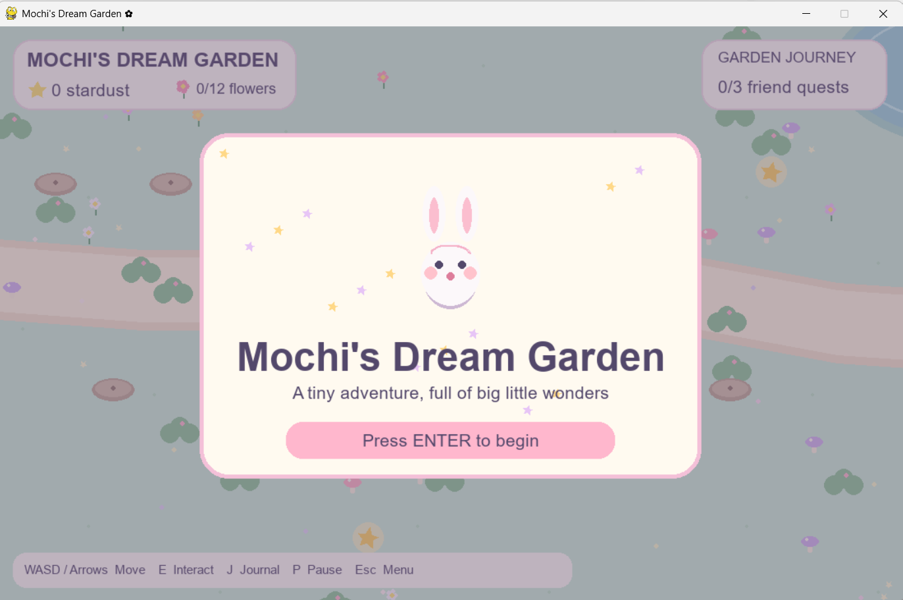
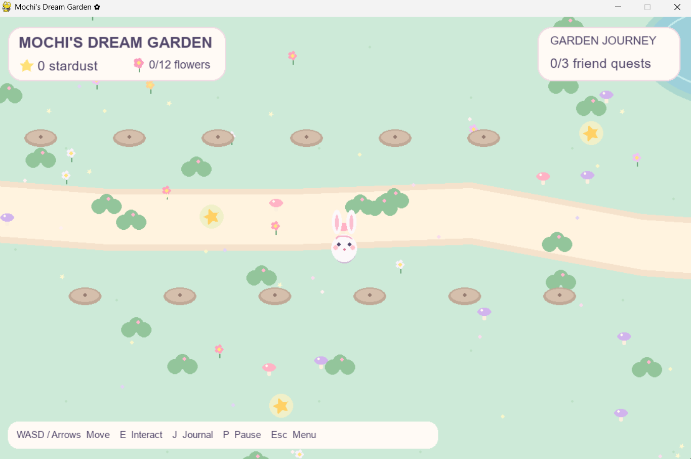
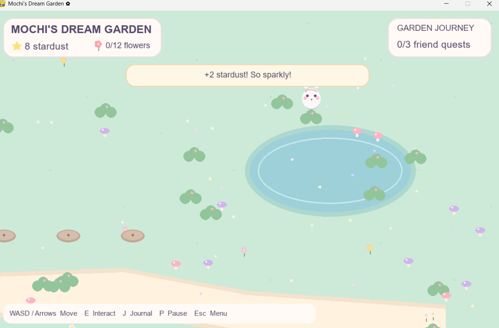
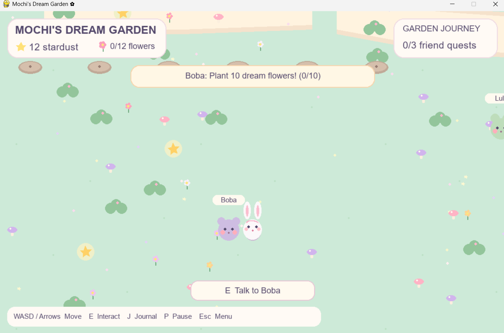
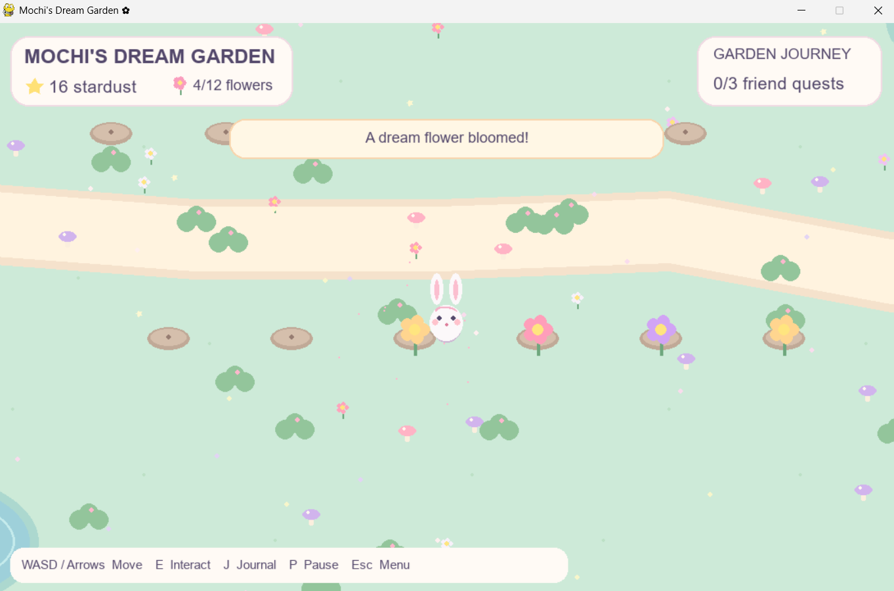
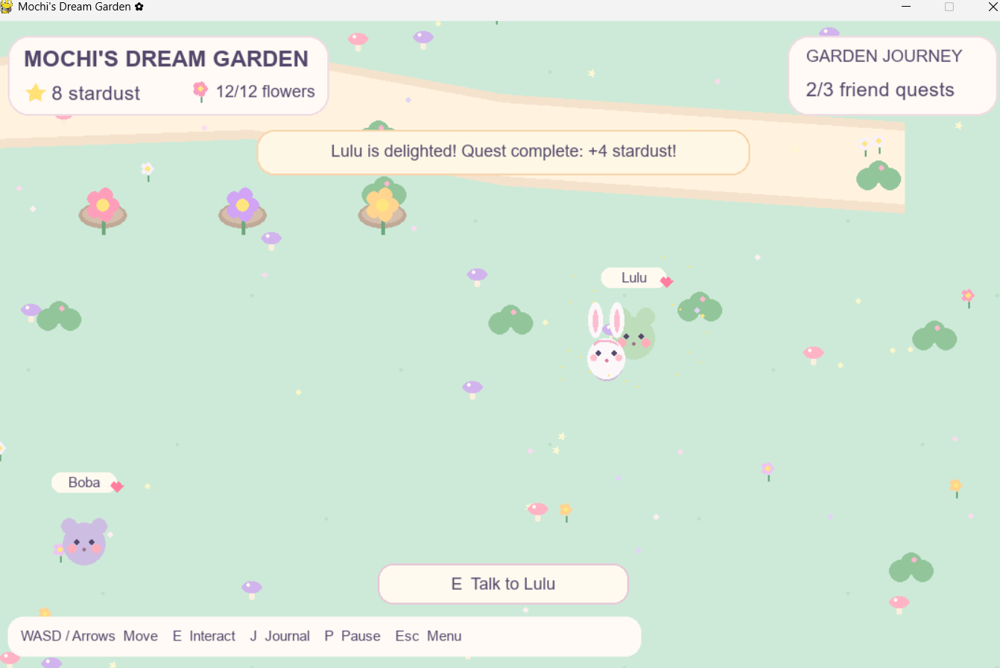
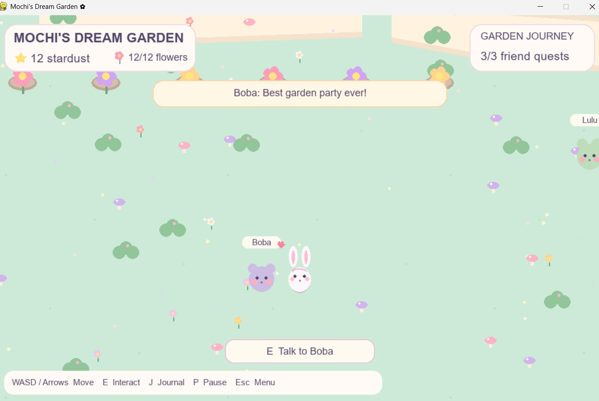
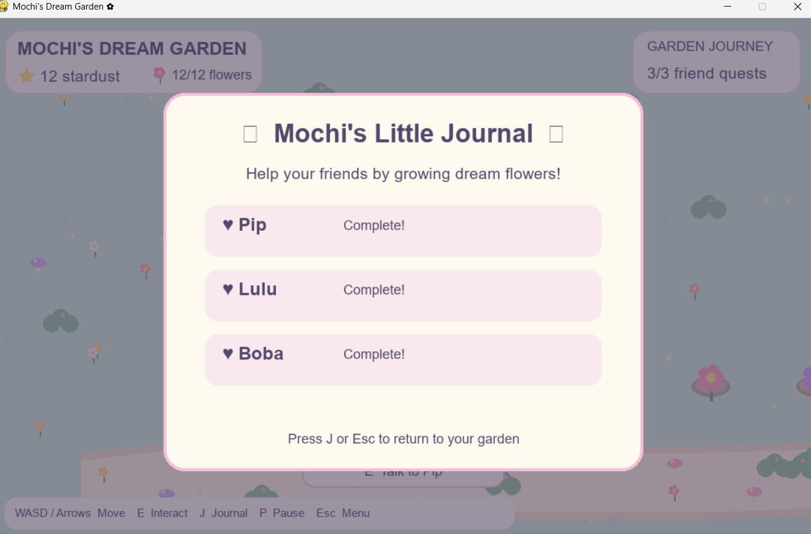

# 🌸 Mochi's Dream Garden

**A cozy, pastel-colored adventure game made with Python and Pygame.** Explore a hand-crafted meadow as Mochi the bunny, collect floating stardust, grow dream flowers, and help three adorable animal friends.

## Features

- 🐰 Animated bunny character with gentle bouncing movement
- 🌼 Twelve garden beds and collectible floating stars
- 🐸 Three animal-friend quests with meaningful progression
- ✨ Original synthesized sound effects and sparkly particle animations
- 🏞️ Large scrolling meadow with ponds, mushrooms, flowers, and pathways
- 📔 In-game quest journal, interaction prompts, and autosaved progress
- 🎨 Cohesive kawaii visual style, drawn procedurally with Pygame
- 💾 Local save file (excluded from Git)

## Quick start — Windows

1. Install **Python 3.10** (or 3.11).
2. Extract the ZIP.
3. Double-click **`START_HERE.bat`** inside `Mochis-Dream-Garden`.
4. On first launch, allow the launcher to install Pygame (internet required).
5. Press **Enter** to begin!

### Alternative: terminal

```powershell
py -3.10 -m pip install -r requirements.txt
py -3.10 main.py
```

## Controls

| Key | Action |
|---|---|
| WASD / Arrow keys | Move Mochi |
| E | Collect stardust, plant a flower, or talk to a friend |
| J | Open/close quest journal |
| P | Pause/resume |
| Enter | Start / continue |
| Esc | Return to menu / close journal |

## How to play

Collect the glowing stars scattered across the meadow (each awards 2 stardust). Stand near a garden bed and press **E** to plant a flower (costs 2 stardust). Meet Pip, Lulu, and Boba and grow **3, 6, and 10 flowers** to finish their quests. Each quest awards bonus stardust. Progress saves automatically to `savegame.json`.

## Screenshots

### Welcome screen



### Explore the pastel meadow



### Collecting stardust



### Meet Boba and accept a quest



### Planting dream flowers



### Completing Lulu’s quest



### Garden party and completed quests



### Completed quest journal




## Project layout

```text
Mochis-Dream-Garden/
├── main.py                 # Game logic, rendering, quest system
├── assets/                 # Original synthesized WAV sound effects
├── screenshots/            # Eight gameplay screenshots embedded in README
├── START_HERE.bat          # Windows Python 3.10/3.11 launcher
├── requirements.txt
├── .gitignore
└── README.md
```

## Implementation notes

All graphics are drawn in Python using Pygame shapes; no copyrighted sprite packs or remote APIs are needed. Sound effects are generated from original synthesized tones. The game does not use machine learning or require model training. It is a local single-player game.

## License

Source code and generated audio assets are released under the MIT License. See `LICENSE`.
